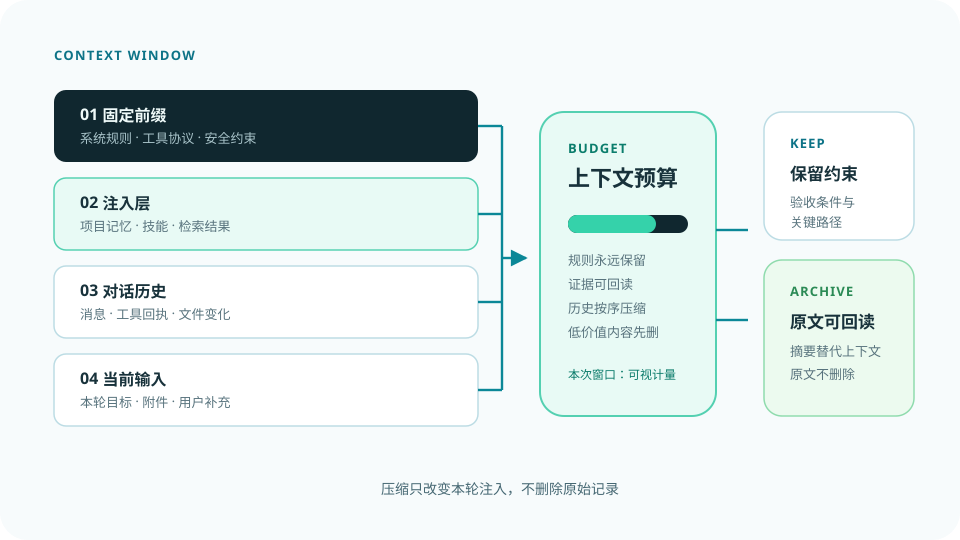

# Nexcore Context Governor

[](https://github.com/yan-stone-computer/nexcore-context-governor/actions/workflows/test.yml)
[](LICENSE)
[](https://nodejs.org/)

**Most agents truncate when context grows. This one budgets, degrades,
checks what survived, and refuses before sending an impossible request.**

This repository is the standalone, dependency-free context-governance core
extracted from [NexcoreWork](https://github.com/yan-stone-computer/nexcorework-site).
It is provider-independent TypeScript and uses only the Node.js standard
library.



## Why this exists

Long-running agents fail in predictable ways:

- one tool result can consume most of the window;
- naïve history summaries silently lose paths, IDs, constraints, or decisions;
- truncating the latest user input produces a request that looks valid but
  cannot succeed;
- safety instructions disappear when the middle of the prompt is rewritten.

This package makes those failure modes explicit. It splits context into four
blocks, measures them separately, applies a fixed degradation order, verifies
retention with deterministic probes, and rejects the request when the latest
input alone cannot fit.

## Architecture

```text
system prefix + injected evidence + conversation history + current input
      |                 |                  |                 |
      +-----------------+------------------+-----------------+
                              measure
                                 |
                   prune old tool results and arguments
                                 |
                    reversible structured compaction
                                 |
                         probe key facts
                                 |
                    shrink lower-priority injection
                                 |
                    refuse if still over budget
```

### Four blocks

| Block | Typical content |
| --- | --- |
| `prefix` | Agent identity, safety rules, tool definitions |
| `injection` | Retrieved knowledge, user memory, project memory, task canvas |
| `session` | Older conversation turns |
| `input` | The latest user turn and current tool results |

The default context ceiling is 70% of the model window. This leaves room for
reasoning and output rather than using the entire advertised limit.

### Ordered degradation

The pipeline is deterministic:

1. clear old tool results and oversized call arguments, retaining receipts and
   recoverable references;
2. compact older session turns into a structured retention record;
3. verify goals, facts, decisions, paths, constraints, and steps with probes;
4. rebuild the safety block at the end of the injected context;
5. shrink low-priority injection content;
6. refuse execution with block-level numbers if the current input still does
   not fit.

No model call is required for budgeting or compaction. The algorithm is
inspectable and testable without a provider.

### Reversible compaction

Compaction produces a stable record instead of an opaque summary:

- task goals and acceptance criteria;
- confirmed facts;
- decisions and reasons;
- open questions;
- artifacts and paths;
- completed tool steps;
- user constraints and receipt references.

The package mutates only the prompt view. Persisting the removed source messages
is the caller's responsibility, and the generated record includes retrieval
references for that purpose.

## Quick start

```bash
git clone https://github.com/yan-stone-computer/nexcore-context-governor.git
cd nexcore-context-governor
npm install
npm run check
```

```ts
import {
  DEFAULT_POLICY,
  govern,
  normalizePolicy,
} from "nexcore-context-governor";

const safety = "Workspace-only file access. Never invent tool results.";

const result = govern({
  messages,
  injection: ["retrieved evidence", safety],
  safety,
  toolsTokens: 1200,
  window: 65_536,
  policy: normalizePolicy(DEFAULT_POLICY),
  previous: null,
  input: latestUserInput,
  steps: toolStepSummaries,
  round: 0,
});

if (result.rejected) {
  return { error: result.rejected, report: result.report };
}

sendToModel(result.messages);
persistCompaction(result.compaction);
```

`messages` is the live prompt representation and may be rewritten by
`govern()`. Keep your canonical conversation/event log separately.

## Observable output

Every result includes:

- four block reports with token counts and drill-down entries;
- the hard ceiling, overflow, cache mode, and degradation actions;
- how many tool results were pruned and how much was freed;
- the structured retention record and probe pass/fail result;
- a final safety block and an explicit refusal message when needed.

This makes context behavior suitable for tests, traces, and user-facing
diagnostics instead of treating truncation as hidden infrastructure.

## Scope and limits

- Token counts are deterministic estimates, not provider billing records.
- Compaction is rule-based and language-sensitive rather than an LLM summary.
- The caller owns durable storage, receipt retrieval, and source retention.
- The current project-region classifier follows the common
  `system / user / assistant / tool` message format. Adapters may need to map
  provider-specific roles before calling the governor.

## Relation to other Nexcore open results

- [NexcoreVision](https://github.com/yan-stone-computer/NexcoreVision) handles
  the visual-evidence branch: OCR and visual analysis become bounded text
  evidence before entering this context budget.
- [EchoMora](https://github.com/yan-stone-computer/EchoMora) explores layered,
  auditable long-term memory and soft forgetting.
- [TianShu2Markdown](https://github.com/yan-stone-computer/tianshu2markdown)
  converts local documents into Markdown for agents.
- [NexcoreWork](https://github.com/yan-stone-computer/nexcorework-site) is the
  complete local-first agent workbench and product documentation.

These projects share design principles, but each repository remains
independently runnable and licensed.

## License

MIT. See [LICENSE](LICENSE).
